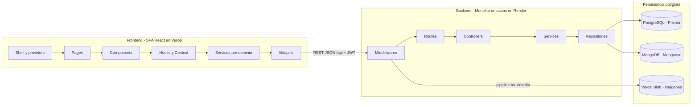

# Arquitectura - Mapa

Arquitectura **real** de ModoFriki, sacada del código de `ModoFriki-Backend` y `ModoFriki-Web`. Las mejoras van aparte en [[Mejoras - Mapa]].

## Capas (colores del grafo)
- 🩷 **Base de datos:** [[BD - Persistencia políglota]] · [[BD - Migraciones]]
- 🩵 **Backend:** [[Backend - Arquitectura en capas]]
- 💚 **Frontend:** [[Frontend - SPA React]]
- ⚪ **Transversal:** [[Principios SOLID]] · [[Patrones de diseño]] · [[Seguridad]] · [[Desarrollo con IA - Mapa]]
- 🩶 **Infraestructura:** [[Despliegue y CI-CD]]
- 🟠 **Mejoras:** [[Mejoras - Mapa]]

## Módulos (dominios) del backend y su feature en el front
| Módulo backend | Feature frontend | Base de datos |
|---|---|---|
| [[Módulo Auth]] | [[Feature Autenticación]] | [[BD - Usuarios y roles]] |
| [[Módulo Catálogo]] | [[Feature Catálogo]] · [[Feature Ficha de obra]] · [[Feature Panel admin]] | [[BD - Catálogo]] · [[BD - Multimedia]] |
| [[Módulo Lectura]] | [[Feature Lector]] · [[Feature Biblioteca y perfil]] | [[BD - Lectura y biblioteca]] |
| [[Módulo Descubrimiento]] | [[Feature Inicio]] | [[BD - Lectura y biblioteca]] |
| [[Módulo Comunidad]] | [[Feature Ficha de obra]] · [[Feature Panel admin]] | [[BD - MongoDB comunidad]] |

Conceptos del dominio: [[Dominio - Mapa]] · Modelo de negocio: [[Negocio - Mapa]] · Inicio: [[ModoFriki - Mapa]]
