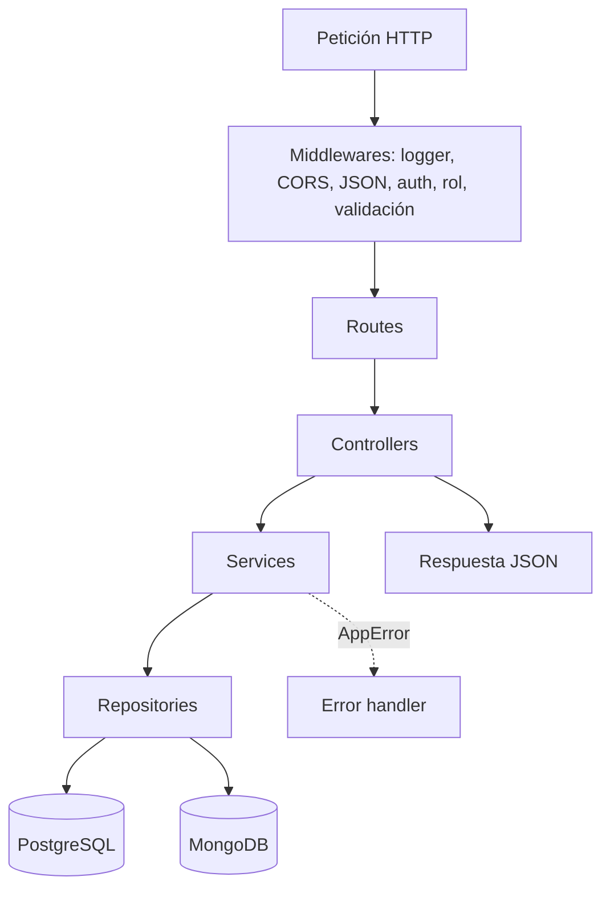

# Backend - Arquitectura en capas

El backend es un **monolito en capas**: una sola aplicación Express, dividida en capas horizontales y en 5 dominios.

| Capa | Carpeta | Regla |
|---|---|---|
| [[Backend - Routes]] | `src/routes/<dominio>.routes.ts` | Solo define endpoints y orden de middlewares |
| [[Backend - Controllers]] | `src/controllers/<dominio>/` | Extrae datos de la petición y responde. Sin Prisma ni Mongoose |
| [[Backend - Services]] | `src/services/<dominio>/` | Reglas de negocio. No conoce Request ni Response |
| [[Backend - Repositories]] | `src/repositories/<dominio>/` | Única capa que habla con la base |
| Validaciones | `src/middlewares/schemas/` | Esquemas Joi |
| Tipos | `src/types/` | Formas de datos y contratos de repositorio |

Regla de dependencias: **cada capa solo llama a la de abajo**.

Dominios: [[Módulo Auth]] · [[Módulo Catálogo]] · [[Módulo Comunidad]] · [[Módulo Lectura]] · [[Módulo Descubrimiento]]
Transversal: [[Backend - Middlewares]] · [[Backend - Pipeline multimedia]] · [[Backend - Respuestas y errores]]
Patrones: [[Inyección de dependencias]] · [[Patrón Repository]] · [[Patrón Factory]]
Mejora propuesta: [[Mejora - Backend organizado por módulos]]
Mapa: [[Arquitectura - Mapa]]
