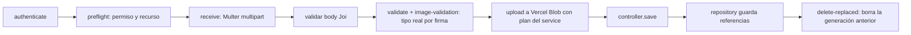

# Backend - Pipeline multimedia

Cadena de middlewares para subir portadas y páginas (`src/middlewares/media/`).

Reglas:
- JPEG, PNG y WebP verificados **por contenido**, no solo por MIME.
- 10 MiB por archivo, 100 MiB en total, 100 páginas por petición, 1000 por capítulo.
- El service arma el **plan** (nombres de archivo); el middleware sube; el repositorio confirma.
- Si falla la base después de subir, el lote queda ABANDONED (no hay transacción distribuida).
- Solo se borran archivos sin referencias y después del commit.

BD: [[BD - Multimedia]] · [[BD - Vercel Blob]] · Módulo: [[Módulo Catálogo]]
Patrones: [[Patrón Chain of Responsibility]] · Mejora: [[Mejora - Limpieza de imágenes huérfanas]]
Capas: [[Backend - Arquitectura en capas]]
