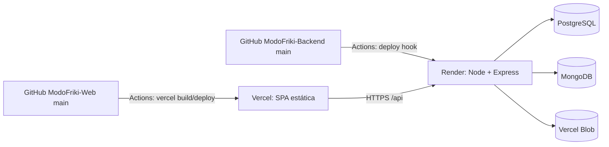

# Despliegue y CI-CD

- **Backend → Render:** al hacer push a `main`, GitHub Actions llama al *deploy hook*. `npm start` aplica migraciones (`prisma migrate deploy`) y arranca.
- **Frontend → Vercel:** push a `main` → `vercel build --prod` y `vercel deploy --prebuilt`.
- Ramas: `feat/*` → `dev` → `qa` → `main` (a `qa` y `main` solo con aprobación humana).
- Variables: `DATABASE_URL`, `MONGODB_URI`, `JWT_SECRET`, `BLOB_READ_WRITE_TOKEN`, `FRONTEND_URL` (back) y `VITE_API_URL` (front).

⚠️ El workflow del backend revisa archivos `.js` en `src/`, pero el código es TypeScript, así que no valida nada → [[Mejora - CI que valide build y tests]].

Mapa: [[Arquitectura - Mapa]]
