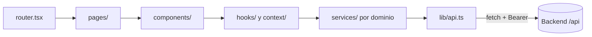

# Frontend - SPA React

**SPA** (aplicación de una sola página) en React 19 + Vite 8 + TypeScript, con React Router 7 y Tailwind 4. Se despliega en Vercel.

> Nota: en el ejemplo del inge el front era Angular. ModoFriki usa **React**.

Flujo de dependencias:

| Carpeta | Contenido |
|---|---|
| `app/` | App, router y providers |
| `pages/` | Una pantalla por ruta |
| `components/` | `ui/` (botón, modal, skeleton…), `layout/` y una carpeta por feature |
| `context/` | Auth, Library, UI |
| `hooks/` | Datos (`useCatalog`, `useReading`…) y utilidades (`useDebounce`, `useHotkeys`…) |
| `services/` | Un archivo por dominio del backend; convierte DTO → tipos del front |
| `lib/` | Cliente HTTP, formato, almacenamiento local |
| `types/` | Tipos del dominio |

Piezas: [[Frontend - Shell y providers]] · [[Frontend - Cliente API]] · [[Frontend - Estado global]] · [[Frontend - Diseño visual]]
Features: [[Feature Inicio]] · [[Feature Catálogo]] · [[Feature Ficha de obra]] · [[Feature Lector]] · [[Feature Biblioteca y perfil]] · [[Feature Autenticación]] · [[Feature Panel admin]]
Mejora propuesta: [[Mejora - Frontend por features y lazy loading]]
Mapa: [[Arquitectura - Mapa]]
