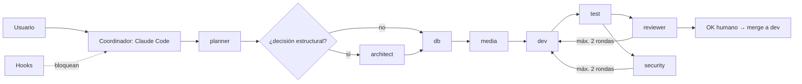

# Desarrollo con IA - Mapa

Cómo se construyó ModoFriki **con agentes de IA**, el tema central de la materia *IA in Software Development*. Todo sale de los archivos `.claude/`, `.opencode/`, `AGENTS.md`, `CLAUDE.md` y `docs/agents/` de los dos repos.

## 🟢 Contexto (qué sabe la IA)
[[Herramientas de IA del proyecto]] · [[Archivos de contexto AGENTS y CLAUDE]] · [[Vault como contexto para la IA]]

## 🔵 Agentes (quién hace qué)
[[Agente planner]] · [[Agente architect]] · [[Agente db]] · [[Agente media]] · [[Agente dev]] · [[Agente test]] · [[Agente reviewer]] · [[Agente security]] · [[Propiedad de archivos por rol]]

## ⚫ Flujo y control (cómo se trabaja y qué se impide)
[[Flujo de una feature con agentes]] · [[Skill modofriki-feature]] · [[Plantilla de plan de feature]] · [[Hooks de Claude Code]] · [[Skills y plugin de OpenCode]] · [[Evaluación de los agentes]] · [[Inconsistencias en la configuración de IA]] · [[Buenas prácticas aprendidas]]

Relacionado: [[BD - Migraciones]] · [[Seguridad]] · [[Despliegue y CI-CD]] · Inicio: [[ModoFriki - Mapa]]
