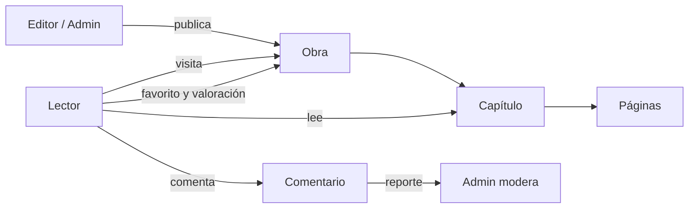

# Dominio - Mapa

Conceptos y reglas de una **plataforma de lectura de cómics**. Es el "segundo cerebro" del dominio, como lo fue *Contabilidad de Costos* para la tienda de inventario. Las reglas salen de `docs/API.md`, `docs/features/` y `prisma/schema.prisma`.

Vocabulario: [[Glosario]]

## 🔵 Contenido
[[Obra]] · [[Capítulo]] · [[Páginas y portadas]] · [[Tipos de obra y géneros]] · [[Estados de publicación]] · [[Flujo de publicación]]

## 🟡 Usuarios
[[Cuenta de usuario]] · [[Roles y permisos]] · [[Asignación de editores]] · [[Auditoría administrativa]]

## 🟢 Lectura
[[Visitas y lecturas]] · [[Flujo de lectura]] · [[Biblioteca personal]] · [[Valoraciones]] · [[Rachas y calendario de lectura]] · [[Rankings y recomendaciones]]

## 🟣 Comunidad
[[Comentarios]] · [[Votos]] · [[Reportes y moderación]]

Implementación: [[Arquitectura - Mapa]] · Negocio: [[Negocio - Mapa]] · Inicio: [[ModoFriki - Mapa]]
