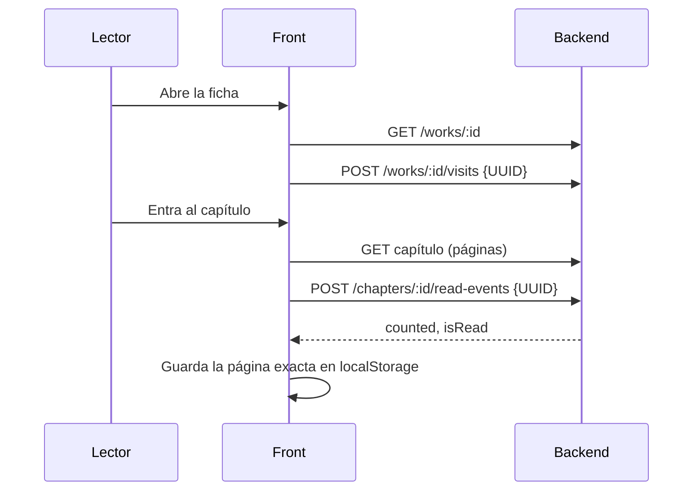

# Flujo de lectura

- Capítulos leídos antes de crear la cuenta: `PUT /me/read-chapters/:id` (marca sin sumar a la racha).
- Para pintar las marcas de leído: `GET /me/works/:id/progress`.

Pantallas: [[Feature Ficha de obra]] · [[Feature Lector]] · Conceptos: [[Visitas y lecturas]] · [[Rachas y calendario de lectura]]
Mapa: [[Dominio - Mapa]]
