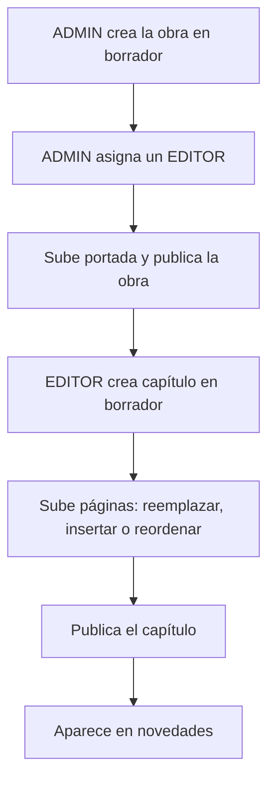

# Flujo de publicación

Cómo un editor publica contenido.

Pantalla: [[Feature Panel admin]] · Reglas: [[Estados de publicación]] · [[Asignación de editores]]
Negocio: en la propuesta, el autor independiente sigue este mismo flujo → [[Programa de autores]]
Mapa: [[Dominio - Mapa]]
