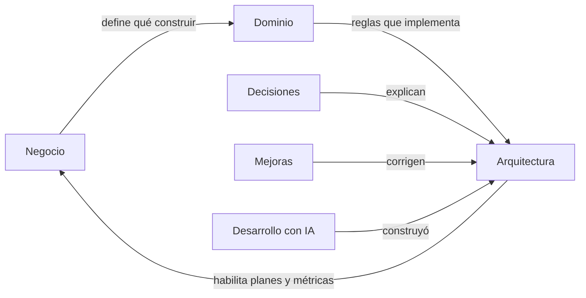

# ModoFriki - Mapa

Nota de inicio del vault de **ModoFriki**, plataforma de lectura de cómics, manhwas, mangas y novelas en español.

## Las seis partes
| Carpeta | Responde | Mapa |
|---|---|---|
| 📚 Dominio | ¿De qué trata? (conceptos y reglas) | [[Dominio - Mapa]] |
| 🏗️ Arquitectura | ¿Cómo está construido? | [[Arquitectura - Mapa]] |
| 🧭 Decisiones | ¿Por qué se hizo así? | [[Decisiones - Mapa]] |
| 🤖 Desarrollo con IA | ¿Cómo se construyó con agentes? | [[Desarrollo con IA - Mapa]] |
| 🛠️ Mejoras | ¿Qué falta mejorar y en qué orden? | [[Mejoras - Mapa]] |
| 💰 Negocio | ¿Cómo gana dinero? | [[Negocio - Mapa]] |

## Archivos de apoyo
- [[CLAUDE.md]]: instrucciones del proyecto para Claude.
- [[Bienvenido]]: nota por defecto de Obsidian.

